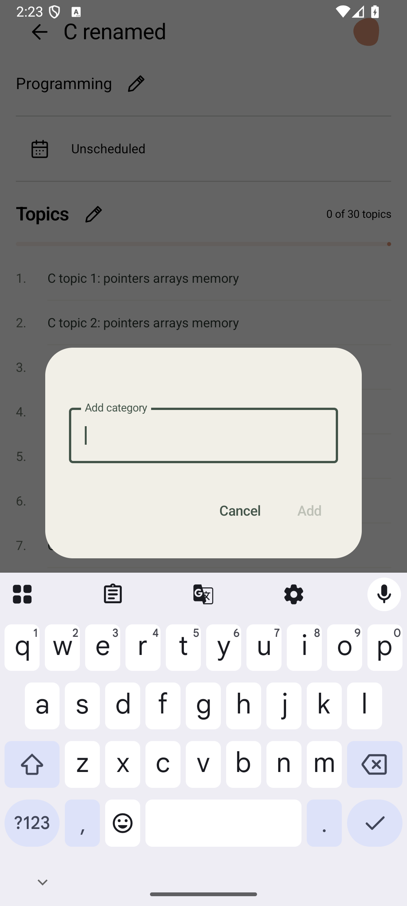
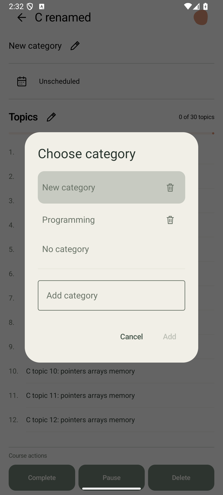

# Ревизия тестов — 2026-10-18

[Состав набора, переименования и правила запуска](../../TESTING.md).
Работа выполнена на `codex/version-02` с сохранением исходных незакоммиченных
изменений окна категории. Код приложения не изменялся в рамках ревизии.

## Найденное и изменения

Число instrumentation-методов сокращено с 251 до 248. Удалены отдельный
тест внутреннего AndroidX Flow и два избыточных репозиторных сценария;
значимые условия объединённого теста очистки списка сохранены. Убраны
повторные итерации одинаковых курсов без расписания, повторные и пустые
assertions. Три Kotlin `assert` заменены JUnit `assertTrue`.

Пять классов получили имена по поведению вместо этапов/общей приёмки.
Названия методов сверены с действующей схемой: темы удаляются, отдельной
таблицы резервов цветов нет, имя и цвет занятия проецируются из курса,
расписание открывается календарём. Миграции старых схем, файловые перезапуски,
сквозные backup/lifecycle-сценарии и реальные alarm-проверки сохранены.
Повторный код ожидания кадров и записи скриншотов объединён в
`TestScreenshots.kt`. Проверка возобновления без расписания перенесена из
визуального класса к `ScheduleRepositoryTest` с фиксированными часами.

## Обнаруженная проблема взаимодействия с IME

Первый полный прогон: 248 методов, 237 успешных, 6 assumption-пропусков,
5 failures. Все failures — тайм-ауты выбора категории после её добавления.
[Исходный лог](logs/before-ime-fix.log).

В текущем окне категории список имеет нулевую высоту при открытой клавиатуре,
но его semantics-узлы продолжают существовать. Старые тесты проверяли
существование строки и нажимали её до появления. Наличие клавиатуры и
отсутствие списка подтверждены снимком перед нажатием:

Общий `selectCategoryOption` закрывает видимую IME системной кнопкой Back,
прокручивает целевую строку и проверяет её видимость перед нажатием.
Тайм-ауты и проверки фактического сохранения не ослаблены; код приложения
не менялся. Направленный повтор пяти падавших сценариев прошёл 5/5:
[лог](logs/category-selection.log). Снимок успешного выбора из полного
повтора просмотрен: категория сохранена в редакторе и выделена в списке,
клавиатура закрыта.

## Дополнительная проверка полного набора

Повтор после исправления IME: 248 методов, 240 успешных, 6 пропусков,
2 failures: второй clipboard-ввод в одном сценарии и получение снимка через
Compose PixelCopy. [Лог](logs/after-ime-fix.log). Причина этих двух тайм-аутов
не установлена; совпадение с параллельной сборкой не доказывает её влияние.

В длинной вставке убран дублирующий цикл отмены: отдельный
`appliedTopicsPersistImmediatelyAndCancelOnlyDiscardsTextarea` сохраняет эту
проверку. Тест длинной вставки продолжает проверять полный исходный текст,
отсутствие записи до Apply, ограничение каждого сохранённого названия и
повторное открытие. Код захвата PixelCopy не менялся для обхода сбоя;
он перепроверяется отдельно и в полном наборе. Отдельный запуск
длинной вставки, отмены и RU/EN-снимков прошёл 4/4:
[лог](logs/clipboard-and-capture.log).

## Проверки

- Сборка debug/androidTest и lint успешны; lint: 0 ошибок, 46 предупреждений.
  [Сборка](logs/build.log), [сборка после уточнения IME](logs/ime-build.log).
- JVM: 36/36; [свежий запуск без кеша задач](logs/jvm-tests.log).
- Утилита оркестрации: 9/9;
  [свежий запуск без кеша задач](logs/orchestrator-tests.log).
- Итоговый полный instrumentation API 36: **242 успешных, 6 assumption-пропусков,
  0 failures**, 248 методов, 327.737 с. [Лог](logs/instrumentation-api36.log).
  Сборки во время этого прогона не запускались. Причина прежнего PixelCopy-
  тайм-аута не установлена; этот успех не отменяет сохранённый failure.
- После последней чистки clipboard-сценария сборка androidTest/lint успешна:
  [лог](logs/clipboard-build.log). `git diff --check` без ошибок.

Использован отдельный временный экземпляр `ScheduleReturnFix`, API 36,
1080 × 2400, density 420, `emulator-5580`, с `-read-only -no-snapshot`.
Данные приложения очищались только в этом экземпляре, сохранённые данные
исходного AVD не перезаписывались. APK устанавливались через `adb install -r`,
полный набор запускался через `adb -s emulator-5580 shell am instrument -w -r
com.utbildning.tracker.test/androidx.test.runner.AndroidJUnitRunner`.
Направленный прогон использовал `-e class` с пятью методами.

Обычный полный прогон не заменяет ночной RTC-сценарий, реальный reboot,
Android 13 или проверку на физическом устройстве. Внешний вид всех экранов
заново не принимался; просмотрены диагностический снимок скрытого списка и снимок успешного выбора.
Один успешный прогон не доказывает отсутствие всех нестабильных UI-тестов.
